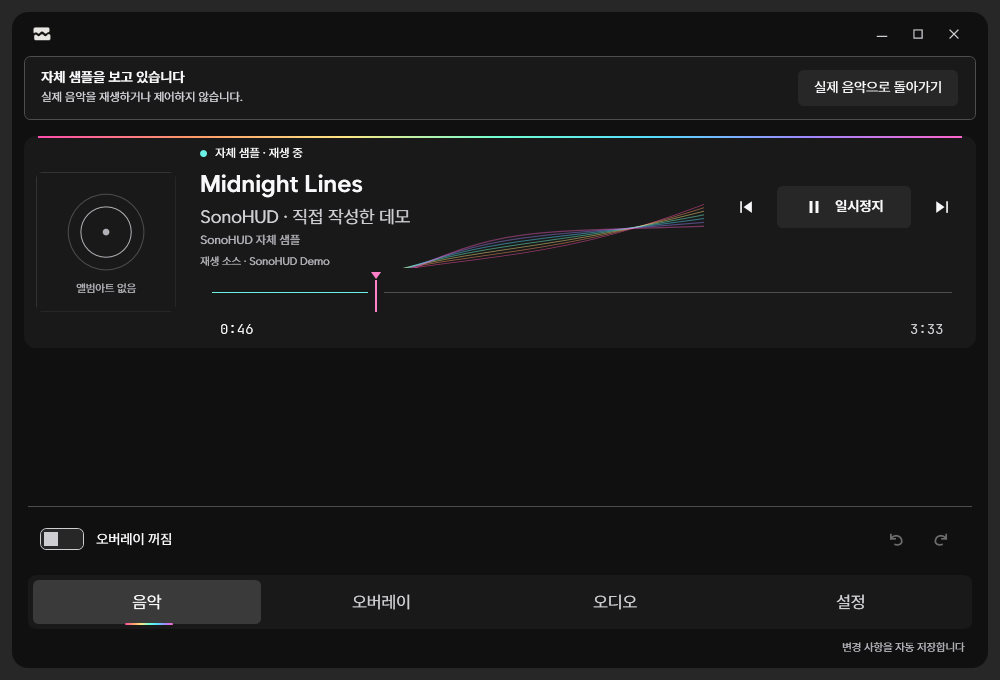

# SonoHUD

SonoHUD is a Windows music player, desktop overlay and taskbar widget. It reads the current track and available transport commands from Windows media sessions. Home and Mini Player share playback state. Seven built-in overlay designs support six themes, including Prism RGB, and an FFT spectrum. [한국어](README.md)

### Install or run portable

Install the x64 .NET 10 **Desktop Runtime** on Windows 11 x64. After the first public release, download **SonoHUD-Setup.exe** from the official Releases page and compare its SHA-256 with the matching manifest. Run Setup as your Windows user and launch SonoHUD from Start. For Portable, extract the whole ZIP into a new directory and run SonoHUD.exe. The installer and app are unsigned. SmartScreen may warn, and Smart App Control or enterprise policy may block execution. [Desktop Runtime](https://dotnet.microsoft.com/en-us/download/dotnet/10.0) · [Planned official releases](https://github.com/Revo-32/sonohud/releases)

Play a track and choose its source in Audio. Installed copies check the stable feed in Settings, verify its ECDSA signature and the package, and restart to apply a downloaded update. Optional sign-in startup opens the tray. Portable updates are manual. User settings and separately approved plugins are stored outside the product payload. If a source is missing, check the player's Windows media integration. If an update fails, keep using the installed version and retry. Windows Settings → Installed apps removes the installation.

Third-party extensions run with the current user's permissions. Review each extension before enabling it. The public Core ships without an online lyrics provider. For development use the Windows x64 SDK version pinned in global.json. [Build](BUILD-EMBEDDED.md) · [Extension SDK](docs/architecture/M7.1-plugin-sdk.md) · [Privacy](docs/release/M7.2-core-privacy.md) · [Security and support](SECURITY.md) · [GPL-3.0-or-later](LICENSE) · [Notices](THIRD-PARTY-NOTICES.md)
