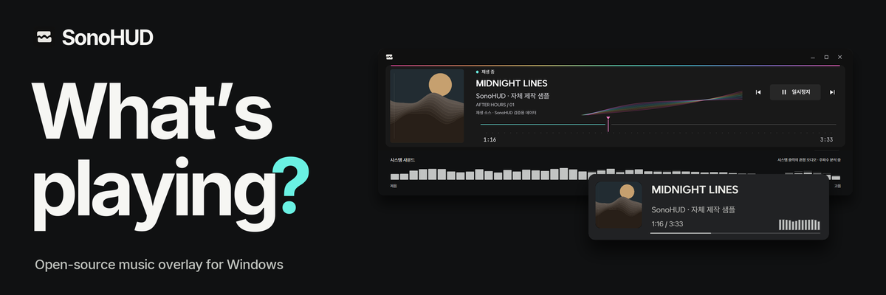
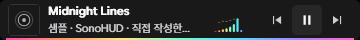

[한국어](README.md) · English

# SonoHUD

See what’s playing in your usual music app, right on your desktop or taskbar. SonoHUD is an open-source music HUD for Windows with a full player view of its own.

**[Download for Windows ↓](https://github.com/Revo-32/sonohud/releases/download/v1.0.0/SonoHUD-Setup.exe)** · [Portable ZIP](https://github.com/Revo-32/sonohud/releases/download/v1.0.0/SonoHUD-v1.0.0-win-x64-portable.zip) · [Corresponding source](https://github.com/Revo-32/sonohud/releases/download/v1.0.0/SonoHUD-v1.0.0-source.zip) · [Latest release](https://github.com/Revo-32/sonohud/releases/latest)

v1.0.0 Stable · Windows 11 x64 · [Requires .NET 10 Desktop Runtime x64](https://dotnet.microsoft.com/en-us/download/dotnet/10.0)

## Three ways to see what’s playing

- **Home player.** See the cover and track details, control playback, or jump to a different point in a song. The mini player controls the same track from the other tabs. Available controls depend on your music app.
- **Desktop overlay.** Choose from seven layouts and position or resize the overlay above your other windows. Enable click-through when you finish editing.
- **Taskbar widget.** Check the song or control playback without opening a window. An FFT spectrum shows the low and high frequencies in your system audio. Choose from six themes, including Prism RGB.

[Home at full size](docs/screenshots/core-home.png) · [Compact overlay](docs/branding/sources/curated/compact.png) · [Layout picker](docs/screenshots/core-overlay.png) · [Compare all six widget themes](docs/screenshots/widget-themes.png)

## Install and play a track

1. Install the **x64 .NET Desktop Runtime 10** for Windows. [Microsoft download](https://dotnet.microsoft.com/en-us/download/dotnet/10.0)
2. For the **installer**, run `SonoHUD-Setup.exe` and open SonoHUD from Start. For **Portable**, extract the entire ZIP into a new folder and run `SonoHUD.exe`.
3. Play a track in your usual music app. If you have more than one player open, choose one in **Audio → Music source** (오디오 → 음악 소스).

The installed app checks the Stable channel in **Settings → Startup and updates** and restarts to apply an update. For Portable, extract the new version into a fresh folder. The installer and app are unsigned. SmartScreen may show a warning, and organization policies can block execution. [SHA-256 checksums](https://github.com/Revo-32/sonohud/releases/download/v1.0.0/SHA256SUMS.txt) · [Install and uninstall guide](docs/release/core-user-guide.md) · [Known limitations](docs/release/known-limitations.md)

## Extensions

The public Core ships without an online lyrics provider. Install a trusted extension under **Settings → Extensions → Install extension…**, review its permissions, and enable it. [Extension SDK](docs/architecture/M7.1-plugin-sdk.md) · [Privacy](docs/release/M7.2-core-privacy.md)

## Development and license

Build on Windows x64 with the .NET SDK version pinned in `global.json`. Use Issues for feature requests and bug reports. Follow the security policy for private reports. [Build instructions](BUILD-EMBEDDED.md) · [Issues](https://github.com/Revo-32/sonohud/issues) · [Security policy](SECURITY.md) · [v1.0.0 release notes](https://github.com/Revo-32/sonohud/releases/tag/v1.0.0)

SonoHUD Core is licensed under GPL-3.0-or-later. The taskbar widget incorporates modified FluentFlyout code. Individual licenses, including MIT for libraries and OFL for fonts, are listed in the notices. [License](LICENSE) · [FluentFlyout credits and changes](licenses/FluentFlyout-v2.16.1/SONOHUD-CHANGES.md) · [Third-party notices](THIRD-PARTY-NOTICES.md)
