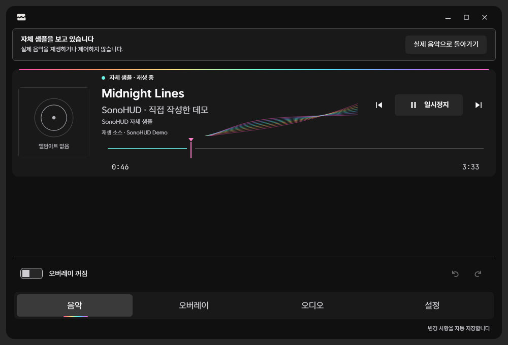
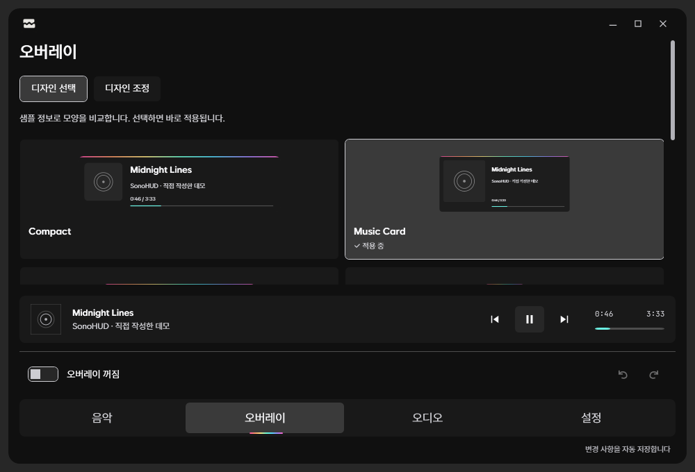

# SonoHUD

Windows에서 듣고 있는 음악의 앨범 커버·곡 정보·스펙트럼을 보여 줍니다. Home에서 곡을 제어하고, 다른 앱을 쓰는 동안에는 클릭 통과 오버레이나 작업 표시줄 위젯으로 확인할 수 있습니다. [English](README.en.md)

### 설치

1. Windows 11 x64에 **.NET 10 Desktop Runtime x64**를 설치합니다. [Microsoft 다운로드](https://dotnet.microsoft.com/en-us/download/dotnet/10.0)
2. 첫 공개 이후 공식 Releases에서 **SonoHUD-Setup.exe**를 받습니다. 같은 릴리스의 SHA256SUMS.txt와 비교하고 실행하세요. 현재는 공개 전이므로 다운로드가 제공되지 않을 수 있습니다. [공식 배포 예정 위치](https://github.com/Revo-32/sonohud/releases)
3. 시작 메뉴에서 SonoHUD를 열고 평소의 플레이어에서 음악을 재생하세요. 소스는 **오디오 → 음악 소스**에서 선택합니다.

Windows 게시자 서명이 없는 프로그램입니다. SmartScreen 경고가 표시되거나 Smart App Control·조직 정책으로 실행이 차단될 수 있습니다. 다운로드 지문 확인은 `Get-FileHash -Algorithm SHA256 -LiteralPath .\SonoHUD-Setup.exe`로 할 수 있습니다. [설치·제거와 문제 해결](docs/release/core-user-guide.md)

### 화면과 기능

두 이미지는 Core 단독의 실제 WPF 화면을 자체 데모 모드에서 렌더링한 것입니다. Home·Mini Player는 Windows 미디어 세션의 곡 정보와 지원되는 재생·탐색 명령을 공유합니다. Windows Composition 오버레이 7종, 6개 테마와 Prism RGB, 작업 표시줄 위젯, 시스템 출력의 FFT 스펙트럼을 제공합니다. 개인 가사 공급자는 별도로 설치·승인하는 확장입니다. [1.0.0 릴리스 노트](docs/release/M8.1-v1.0.0-release-notes.md)

### 업데이트와 시작

설치형은 설정에서 Stable 업데이트를 확인합니다. 서명된 인덱스와 패키지가 확인되면 다운로드하고 재시작해 적용할 수 있습니다. **Windows 로그인 시 트레이에서 시작**은 설정에서 켜며 기본값은 꺼짐입니다. Portable은 ZIP 전체를 새 폴더에 푼 뒤 `SonoHUD.exe`를 열고, 버전을 바꿀 때는 종료 후 새 버전을 별도 폴더에 풉니다. [설치·업데이트·설정 보존 정책](docs/release/core-user-guide.md) · [알려진 제한](docs/release/known-limitations.md)

### 확장·개발·지원

설정의 **확장 기능**에서 신뢰하는 DLL만 선택해 설치하고 권한을 확인한 뒤 활성화하세요. 곡이 표시되지 않으면 음악 플레이어의 Windows 미디어 연동과 선택된 소스를 먼저 확인하세요. 업데이트 연결이 실패하면 기존 설치를 계속 사용할 수 있습니다. 공개 이후 재현 가능한 기능 오류는 공식 저장소 Issues에서 접수합니다. 보안 보고에는 키·토큰·사용자 데이터·가사 원문을 올리지 마세요. [개인정보](docs/release/M7.2-core-privacy.md) · [보안 및 지원](SECURITY.md)

개발은 Windows x64와 global.json에 고정한 .NET 10 SDK를 사용합니다. Core 라이선스는 GPL-3.0-or-later입니다. [빌드 절차](BUILD-EMBEDDED.md) · [플러그인 SDK](docs/architecture/M7.1-plugin-sdk.md) · [배포 절차](docs/release/release-pipeline.md) · [LICENSE](LICENSE) · [제3자 고지](THIRD-PARTY-NOTICES.md)
